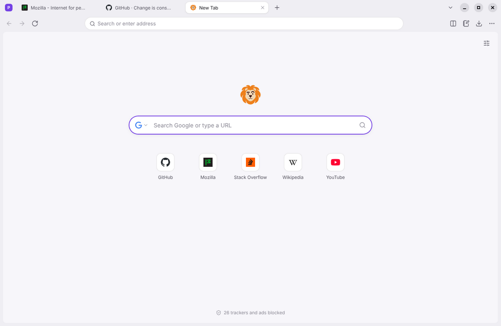
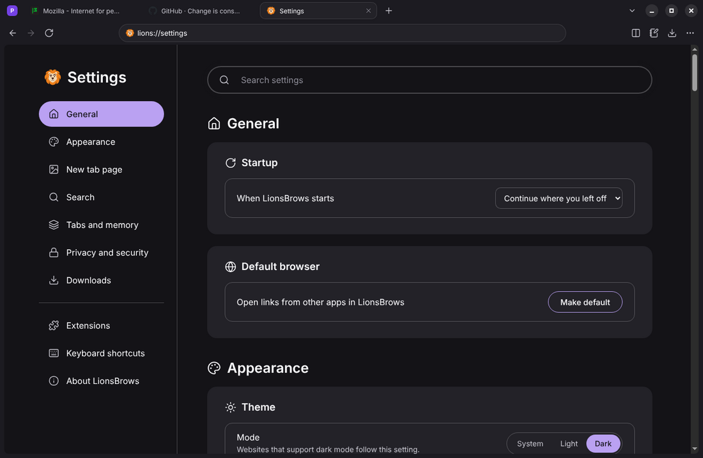
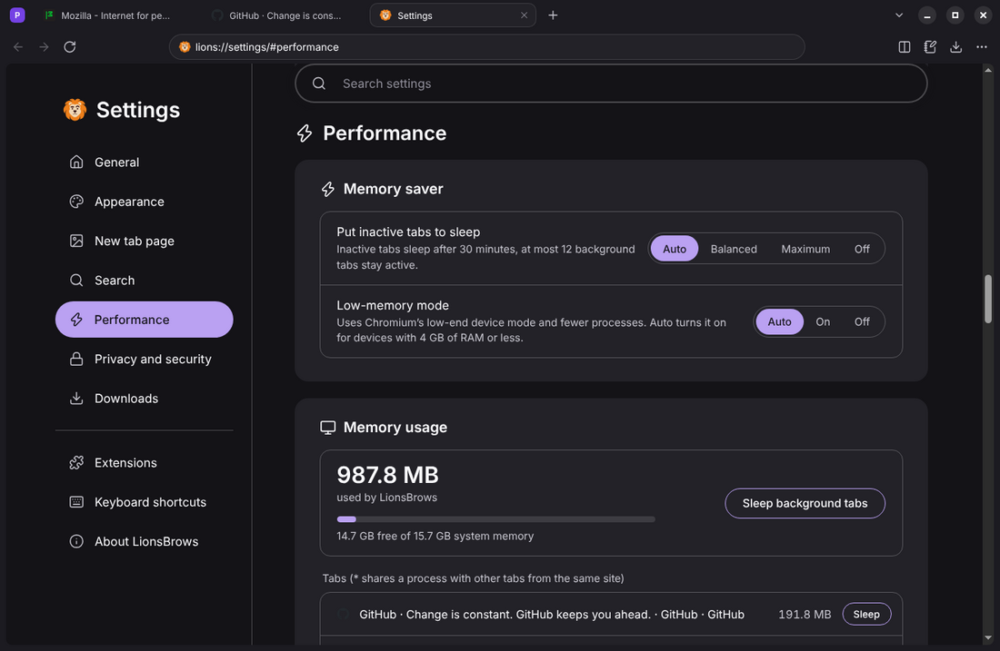
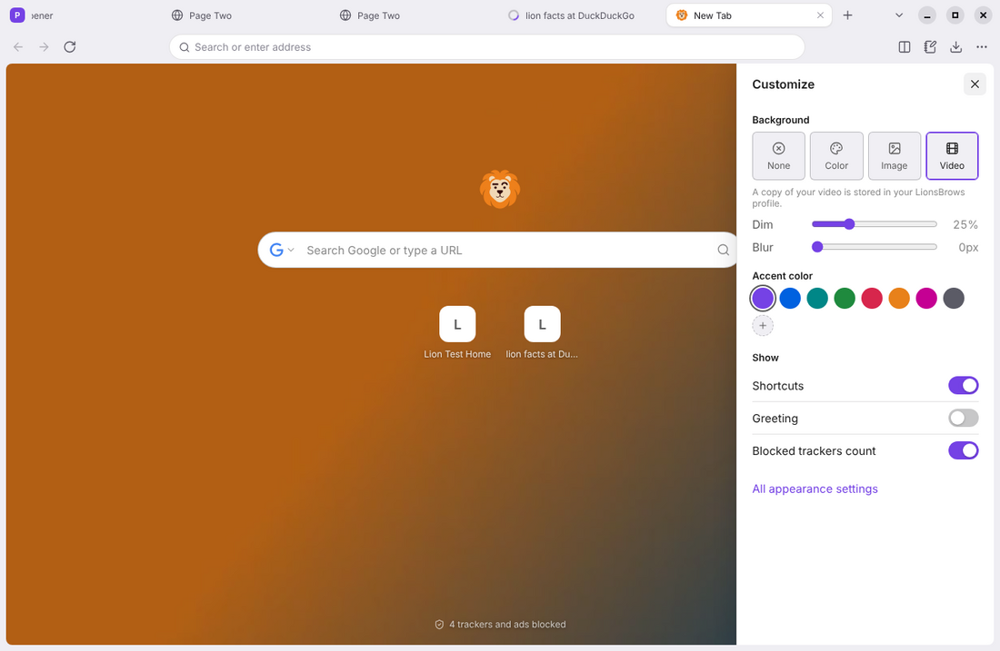
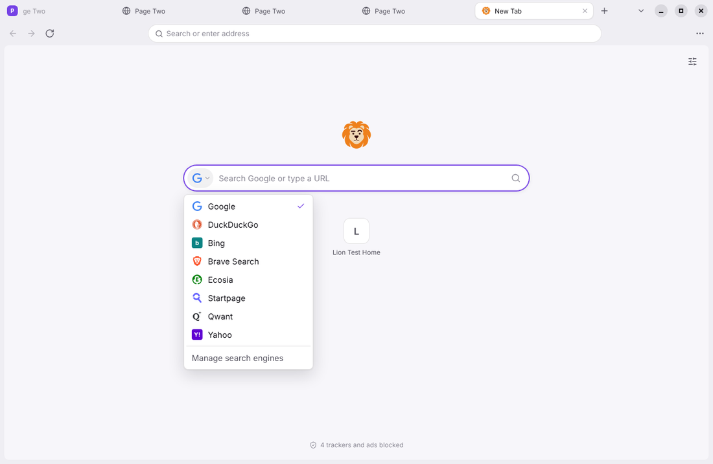
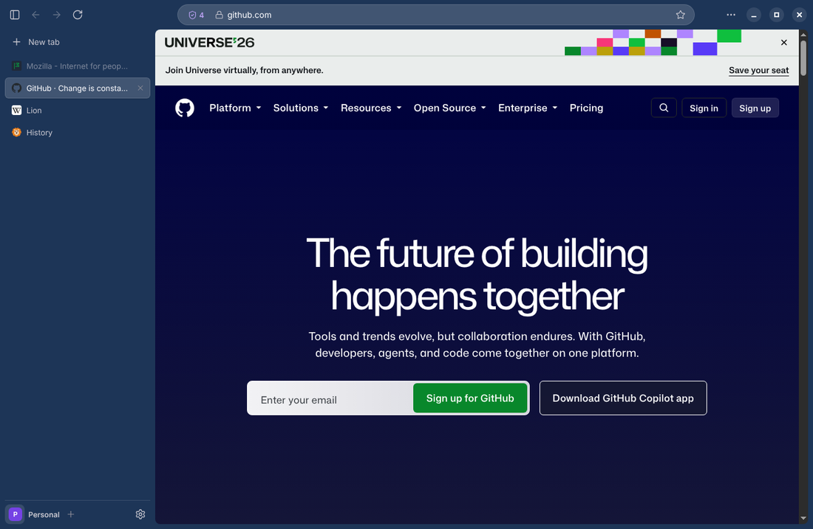
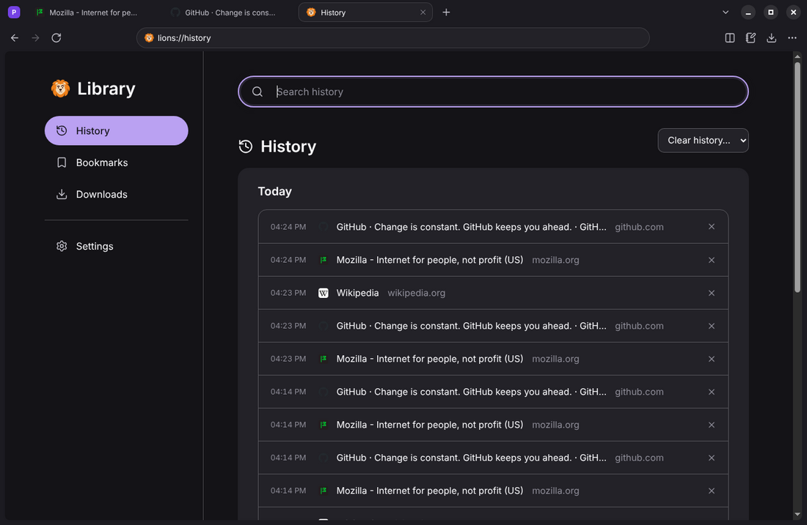
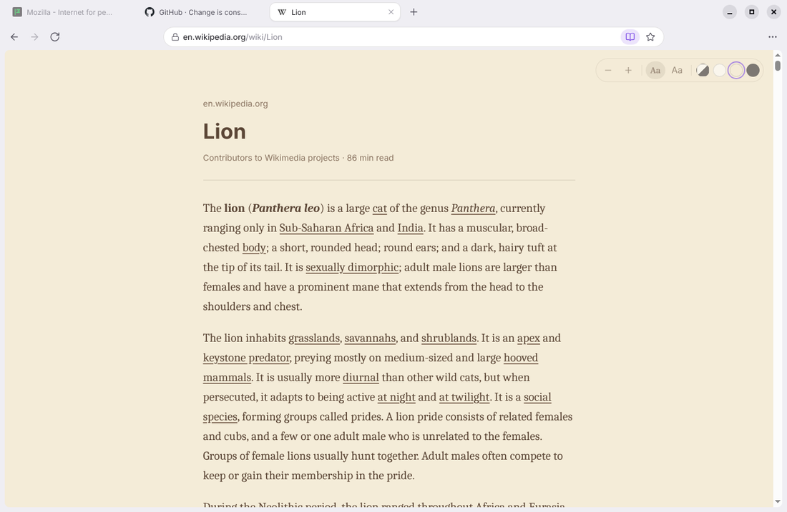

<p align="center">
  
</p>

<h1 align="center">LionsBrows</h1>

<p align="center">Everything you need in a browser, nothing you don't. A fast, private, minimal browser built on Chromium that runs well on low-memory devices.</p>

<p align="center"><a href="https://aivie373736.github.io/LionsBrows/">Website</a> · <a href="../../releases/latest">Download</a></p>

<p align="center">
  
</p>

## Features

- **Tabs your way:** tabs on top or in a vertical sidebar, pinned tabs, drag to reorder, and inactive tabs that sleep to save memory.
- **Workspaces:** separate sets of tabs, optionally with their own cookies so you can stay signed in to two accounts at once.
- **Split view:** two tabs side by side with an adjustable divider.
- **Command bar:** press <kbd>Ctrl</kbd>+<kbd>K</kbd> to search open tabs, bookmarks, history and commands. It also does calculations and supports site shortcuts such as `!yt` and `!w`.
- **Search engine choice:** pick Google, DuckDuckGo, Bing, Brave Search, Ecosia, Startpage, Qwant, Yahoo or a custom engine, right from the new tab page.
- **Personalization:** use your own video, image or a solid color as the new tab background. You can also choose the accent color and toolbar color, and switch between light and dark mode.
- **Made for low-memory devices:** Memory saver puts inactive tabs to sleep and limits how many background tabs stay active. Low-memory mode uses fewer processes and smaller caches. Both turn on automatically on devices with 4 GB of RAM or less, and when the system runs low on memory, background tabs are suspended immediately. Settings shows memory usage per tab.
- **Tracking protection:** built-in ad and tracker blocking with per-site exceptions, warnings before known phishing and malware sites, hidden cookie banners, optional third-party cookie blocking, deleting cookies when the browser closes, automatic HTTPS upgrades, Global Privacy Control, blocking of autoplaying sound and private windows. Click the lock in the address bar to see a site's connection, change its camera, microphone, location and notification permissions, or delete its cookies.
- **First-start setup:** a short assistant on first launch to choose camera, microphone, location and notification permissions, Standard or Strict protection, what happens to cookies, importing from another browser and the look.
- **Minimal by default:** the toolbar only shows back, forward, reload, the address bar and the menu. Downloads, split view and notes appear when you need them, and you can add buttons back with a right-click on the toolbar.
- **Password manager:** offers to save logins, fills them in, suggests strong passwords on sign-up forms, and keeps them encrypted with Windows DPAPI, the macOS Keychain or the Linux keyring. Import and export CSV files from Chrome, Edge, Firefox, Brave and Bitwarden.
- **Chrome extensions:** add extensions straight from the Chrome Web Store. They appear in the toolbar with their popups and badges, update automatically, and can be pinned or removed with a right-click. Packages are checked against the developer's signature before they are installed.
- **Reader view:** one click turns cluttered articles into clean text, with font, size and light, sepia or dark themes.
- **Import from other browsers:** bring over bookmarks and history from Chrome, Edge, Brave, Vivaldi, Opera and Firefox.
- **Automatic updates:** new versions download in the background and install on restart.
- **Streaming:** Netflix, Spotify, Disney+ and other services that use Widevine DRM, via castLabs' Electron for Content Security.
- **English and German:** the language follows your system and can be changed in Settings.
- **Everyday tools:** history, recently closed tabs and windows, bookmarks with import and export, a download manager, find in page, zoom, full-page screenshots, a PDF viewer, spell check, session restore and a notes panel.

<p align="center">
  
  
  
  
  
  
  
</p>

## Download

Installers are built by GitHub Actions on every push:

| System | Download |
|---|---|
| Windows 10/11 (Intel/AMD) | [`LionsBrows-win-x64.exe`](../../releases/latest/download/LionsBrows-win-x64.exe) |
| Windows 11 on ARM | [`LionsBrows-win-arm64.exe`](../../releases/latest/download/LionsBrows-win-arm64.exe) |
| macOS (Apple silicon / Intel) | [`LionsBrows-mac-arm64.dmg`](../../releases/latest/download/LionsBrows-mac-arm64.dmg) / [`LionsBrows-mac-x64.dmg`](../../releases/latest/download/LionsBrows-mac-x64.dmg) |
| Linux (x64) | [`LionsBrows-linux-x86_64.AppImage`](../../releases/latest/download/LionsBrows-linux-x86_64.AppImage) |
| Linux on ARM (e.g. Raspberry Pi 4/5, 64-bit OS) | [`LionsBrows-linux-arm64.AppImage`](../../releases/latest/download/LionsBrows-linux-arm64.AppImage) |

- Tagged versions are published on the [Releases](../../releases) page.
- The latest build is available from the [Actions](../../actions) tab: open the most recent successful run and download the artifact for your system.

The builds are not code-signed yet. On Windows, SmartScreen may show a warning (select *More info*, then *Run anyway*). On macOS, run `xattr -cr /Applications/LionsBrows.app` if the app is reported as damaged.

## Keyboard shortcuts

| Action | Windows / Linux | macOS |
|---|---|---|
| Command bar | <kbd>Ctrl</kbd>+<kbd>K</kbd> | <kbd>⌘</kbd><kbd>K</kbd> |
| Edit address | <kbd>Ctrl</kbd>+<kbd>L</kbd> | <kbd>⌘</kbd><kbd>L</kbd> |
| New tab / close tab | <kbd>Ctrl</kbd>+<kbd>T</kbd> / <kbd>Ctrl</kbd>+<kbd>W</kbd> | <kbd>⌘</kbd><kbd>T</kbd> / <kbd>⌘</kbd><kbd>W</kbd> |
| Reopen closed tab | <kbd>Ctrl</kbd>+<kbd>Shift</kbd>+<kbd>T</kbd> | <kbd>⌘</kbd><kbd>⇧</kbd><kbd>T</kbd> |
| Split view | <kbd>Ctrl</kbd>+<kbd>\\</kbd> | <kbd>⌘</kbd><kbd>\\</kbd> |
| Find in page | <kbd>Ctrl</kbd>+<kbd>F</kbd> | <kbd>⌘</kbd><kbd>F</kbd> |
| Reader view | <kbd>Ctrl</kbd>+<kbd>Alt</kbd>+<kbd>R</kbd> or <kbd>F9</kbd> | <kbd>⌘</kbd><kbd>⌥</kbd><kbd>R</kbd> |
| Private window | <kbd>Ctrl</kbd>+<kbd>Shift</kbd>+<kbd>N</kbd> | <kbd>⌘</kbd><kbd>⇧</kbd><kbd>N</kbd> |

All shortcuts are listed under *Settings → Keyboard shortcuts*.

## Development

Requires Node.js 22 or later.

```bash
git clone https://github.com/aivie373736/LionsBrows.git
cd LionsBrows
npm install
npm start
```

| Command | Description |
|---|---|
| `npm start` | Run the browser |
| `npm test` | Unit tests |
| `npm run test:e2e` | End-to-end tests (requires Playwright; on Linux run with `xvfb-run -a`) |
| `npm run dist` | Build an installer for the current platform |
| `npm run icons` | Regenerate icon assets |

### Project structure

```
src/
  main/      main process: windows, tabs, sessions, ad blocking, history, downloads, settings
  preload/   bridges between pages and the main process
  ui/        browser interface and command bar
  pages/     built-in pages: new tab, settings, history, bookmarks, downloads, errors
  shared/    logo, icons and theme
```

LionsBrows runs on [Electron](https://www.electronjs.org) (castLabs build with Widevine). Every page is sandboxed with context isolation and no Node.js access. Built-in `lions://` pages use a small API that the main process validates on every call.

### Widevine signing

LionsBrows uses [Electron for Content Security](https://github.com/castlabs/electron-releases) by castLabs, which installs Google's Widevine module on first launch. Services such as Netflix and Spotify also require a production VMP signature on Windows and macOS. The build signs automatically when the repository has the secrets `EVS_ACCOUNT_NAME` and `EVS_PASSWD` of a free [castLabs EVS](https://github.com/castlabs/electron-releases/wiki/EVS) account.

### Known limitations

- Extensions get the Chrome APIs that Electron and [electron-chrome-extensions](https://github.com/samuelmaddock/electron-browser-shell) provide. Most extensions work, but `chrome.webRequest` listeners are not called and some newer APIs are missing, so a few extensions only work partly. Extensions do not run in private windows.
- There is no sync between devices.
- Some streaming services only play in builds that are VMP-signed with a castLabs EVS account (see below).
- Automatic updates need the GitHub releases to be public.

## License

[MIT](LICENSE). Third-party components are listed in [THIRD_PARTY_NOTICES.md](THIRD_PARTY_NOTICES.md).
