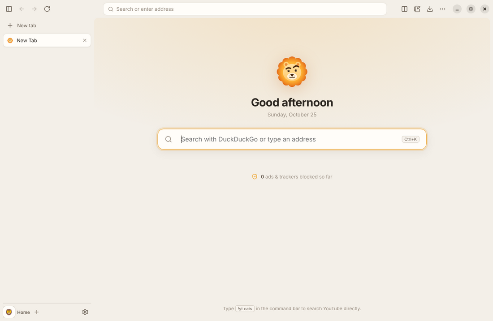
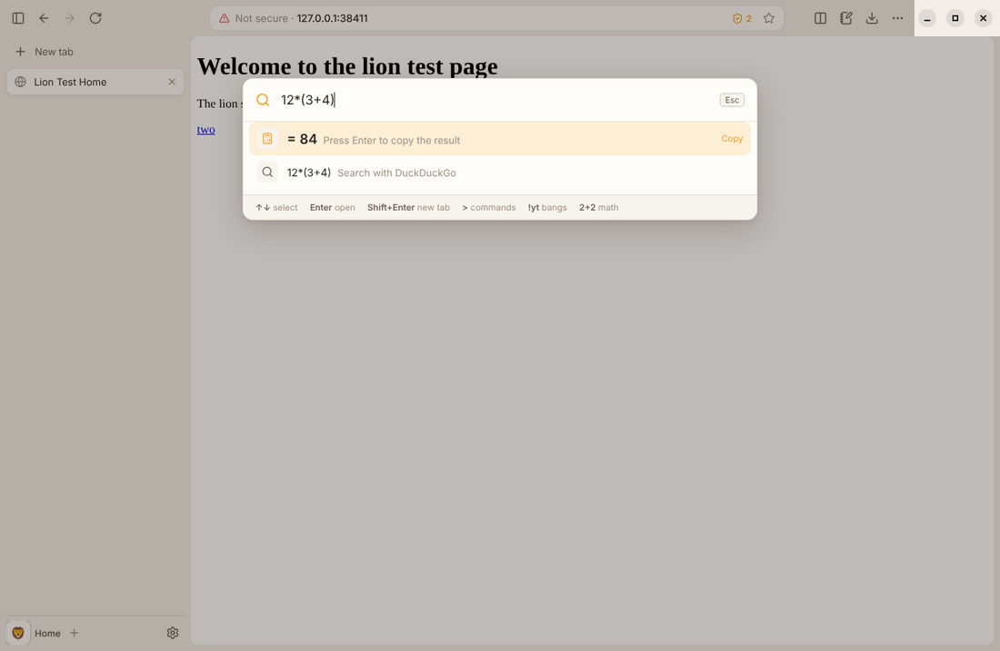
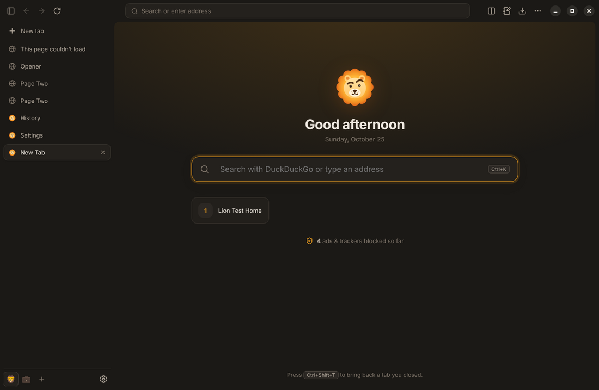
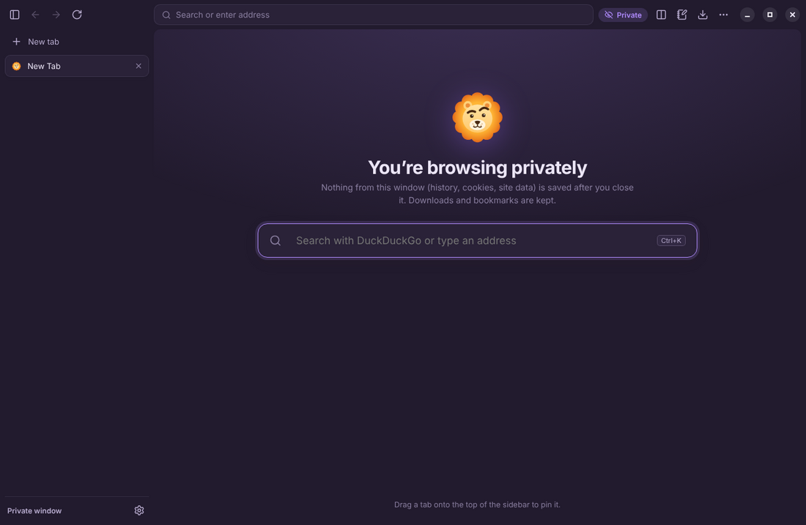
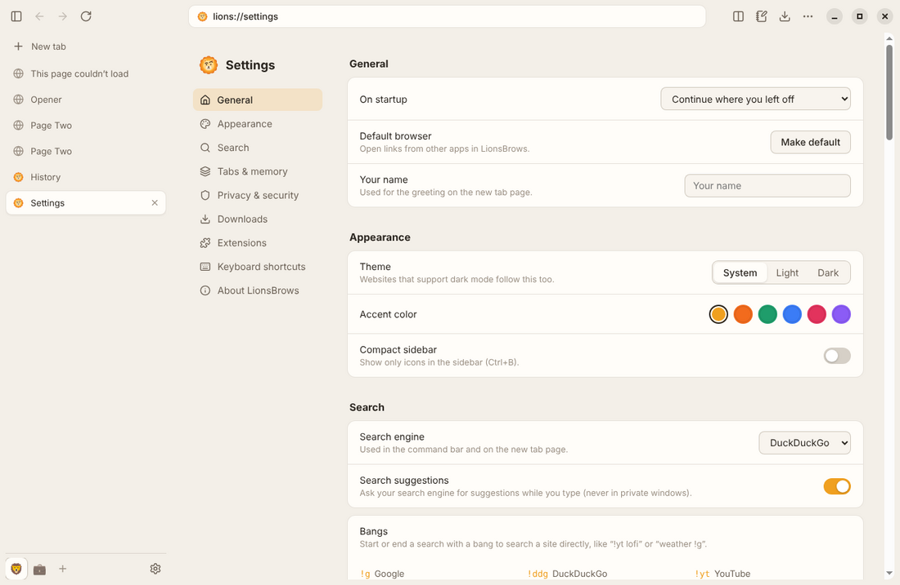

<p align="center">
  
</p>

<h1 align="center">LionsBrows</h1>

<p align="center">
  A fast, private browser built on Chromium, with vertical tabs, workspaces, split view, a command bar and a built-in ad blocker.<br>
  <sub>(Lion + eyebrows + browser. Yes, the lion is raising one eyebrow at the ads.)</sub>
</p>

<p align="center">
  
</p>

## Features

| | |
|---|---|
| **Vertical tabs** | Tabs live in a sidebar, so long titles stay readable. Drag to reorder; drag to the top to **pin**. Collapse the sidebar to icons with <kbd>Ctrl</kbd>+<kbd>B</kbd>. |
| **Workspaces** | Separate sets of tabs for work, school or gaming. One click to switch. Right-click a workspace and turn on **separate logins** to be signed in to two accounts at once. |
| **Split view** | Two tabs side by side (<kbd>Ctrl</kbd>+<kbd>\\</kbd>). Drag the divider to resize. |
| **Command bar** | <kbd>Ctrl</kbd>+<kbd>K</kbd> searches open tabs, bookmarks, history and the web, runs any command (type `>`), does math (`12*(3+4)`) and supports **bangs**: `!yt lofi`, `!w lions`, `!gh electron`. |
| **Ad & tracker blocker** | Built in and on by default (EasyList, EasyPrivacy and more, through Ghostery's engine). The shield in the address bar shows the count and turns blocking off per site. |
| **Privacy** | No telemetry. Automatic HTTPS upgrades, Global Privacy Control, private windows with in-memory sessions, and per-site permission prompts for camera, mic and location. |
| **Tab sleeping** | Background tabs go to sleep after 30 minutes (configurable) to free memory, then wake up instantly with their back/forward history. |
| **Notes** | A notepad in the side panel (<kbd>Ctrl</kbd>+<kbd>E</kbd>), one per workspace, saved automatically. |
| **The basics, done properly** | History with search, bookmarks (with import/export from Chrome/Firefox/Edge), a download manager, find in page, zoom, full-page screenshots, PDF viewer, spell check, session restore, reopen closed tabs, picture-in-picture, dark mode, accent colors. |

<p align="center">
  
  
  
  
</p>

## Download

Installers for **Windows**, **macOS** and **Linux** are built automatically by GitHub Actions:

- **Releases:** see the [Releases page](../../releases) for tagged versions.
- **Latest build:** open the [Actions tab](../../actions), pick the newest green run, and download `LionsBrows-Windows` / `-macOS` / `-Linux` under *Artifacts*.

Notes:
- **Windows:** the installer isn't code-signed yet, so SmartScreen may warn. Click *More info → Run anyway*. To make LionsBrows your default browser, open *Settings → Default browser* inside LionsBrows.
- **macOS:** the app isn't notarized. If macOS says it's damaged, run `xattr -cr /Applications/LionsBrows.app` once.

## Keyboard shortcuts

| Action | Windows / Linux | macOS |
|---|---|---|
| Command bar | <kbd>Ctrl</kbd>+<kbd>K</kbd> | <kbd>⌘</kbd><kbd>K</kbd> |
| Edit address | <kbd>Ctrl</kbd>+<kbd>L</kbd> | <kbd>⌘</kbd><kbd>L</kbd> |
| New tab / close tab | <kbd>Ctrl</kbd>+<kbd>T</kbd> / <kbd>Ctrl</kbd>+<kbd>W</kbd> | <kbd>⌘</kbd><kbd>T</kbd> / <kbd>⌘</kbd><kbd>W</kbd> |
| Reopen closed tab | <kbd>Ctrl</kbd>+<kbd>Shift</kbd>+<kbd>T</kbd> | <kbd>⌘</kbd><kbd>⇧</kbd><kbd>T</kbd> |
| Split view | <kbd>Ctrl</kbd>+<kbd>\\</kbd> | <kbd>⌘</kbd><kbd>\\</kbd> |
| Toggle sidebar | <kbd>Ctrl</kbd>+<kbd>B</kbd> | <kbd>⌘</kbd><kbd>B</kbd> |
| Notes / downloads | <kbd>Ctrl</kbd>+<kbd>E</kbd> / <kbd>Ctrl</kbd>+<kbd>J</kbd> | <kbd>⌘</kbd><kbd>E</kbd> / <kbd>⌘</kbd><kbd>⇧</kbd><kbd>J</kbd> |
| Private window | <kbd>Ctrl</kbd>+<kbd>Shift</kbd>+<kbd>N</kbd> | <kbd>⌘</kbd><kbd>⇧</kbd><kbd>N</kbd> |

The full list is in *Settings → Keyboard shortcuts*. Press <kbd>Ctrl</kbd>+<kbd>K</kbd> and type `>` to search every command.

## Development

You need [Node.js](https://nodejs.org) 22 or newer.

```bash
git clone https://github.com/aivie373736/LionsBrows.git
cd LionsBrows
npm install
npm start          # run the browser
npm test           # unit tests
npm run test:e2e   # end-to-end tests (needs Playwright: npm i -D playwright)
npm run dist       # build an installer for your OS into dist/
```

On Linux without a screen, run the end-to-end tests with `xvfb-run -a npm run test:e2e`. Add `SHOTS=./shots` to save screenshots.

### How it's built

LionsBrows runs on [Electron](https://www.electronjs.org), so pages render with the same Chromium engine as Chrome. Everything around the pages is LionsBrows' own code:

```
src/
  main/        the "engine room" (Node.js, main process)
    window.js      a browser window: the UI view + tab views + command bar overlay, layout, split view, workspaces
    tab.js         one tab: its page, navigation, sleeping/waking, errors, zoom
    sessions.js    per-workspace / private sessions: user agent, HTTPS upgrade, privacy headers
    adblock.js     Ghostery filter engine wired into every session, with per-site allowlist
    palette.js     the command bar: tabs, history, bookmarks, commands, math, search suggestions
    actions.js     every command in one table (shortcuts, menus and the command bar use it)
    history.js     SQLite history (Node's built-in node:sqlite) with frecency ranking
    ...            downloads, permissions, bookmarks, menus, session restore, extensions
  preload/     the tiny, locked-down bridges between pages and the main process
  ui/          the browser chrome (sidebar, toolbar, panels) and the command bar overlay
  pages/       built-in lions:// pages: new tab, settings, history, bookmarks, downloads, errors
  shared/      logo, icons and design tokens shared by the UI and pages
```

Security basics: every page runs sandboxed with context isolation and without Node.js. Websites get no special APIs. LionsBrows' own `lions://` pages get a small API, and the main process re-checks the caller on every call.

### Known limitations

- Chrome Web Store extensions don't install directly. *Settings → Extensions* can load unpacked extensions (experimental; Electron supports only part of the extension APIs).
- There's no built-in password manager or sync yet.
- Some Google sign-in flows can reject Chromium-based browsers that aren't Chrome. LionsBrows sends a standard Chrome user agent to avoid this.

## Credits

- [Electron](https://www.electronjs.org) and [Chromium](https://www.chromium.org)
- [@ghostery/adblocker](https://github.com/ghostery/adblocker) (MPL-2.0) for ad and tracker blocking
- [Lucide](https://lucide.dev) icons (ISC)
- [tldts](https://github.com/remusao/tldts) for domain parsing

## License

[MIT](LICENSE)
